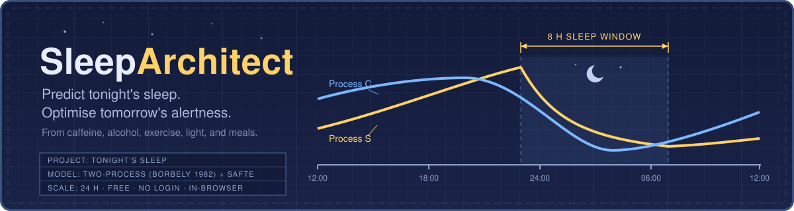

<div align="center">



<br/>

[](https://github.com/AnwarDebes/SleepArchitect/releases)
[](pyproject.toml)
[](LICENSE)
[](tests/test_sleeparchitect.py)
[](frontend/)

**Predict tonight's sleep, optimise tomorrow's alertness. Free, no login, runs entirely in your browser.**

**[Open the live app](https://anwardebes.github.io/SleepArchitect/)**

</div>

---

Existing sleep apps (Oura, Whoop, Apple Health, Sleep Cycle,
AutoSleep) are *retrospective*: they tell you how you slept last
night. None *predict* tonight's sleep from today's caffeine,
alcohol, exercise, light, and meal timing. Yet the underlying
40-year-old quantitative model (Borbely's two-process model) is
well-validated.

SleepArchitect closes that gap. It composes:

* **Process S** (homeostatic sleep pressure, Borbely 1982 / Daan 1984)
* **Process C** (circadian, Skeldon 2017)
* **Light PRC** (Khalsa 2003) + melatonin suppression (Brainard 2001)
* **Caffeine PK** + SWS suppression (Drake 2013, Clark & Landolt 2017)
* **Alcohol PK** + first-half REM suppression (Ebrahim 2013)
* **Exercise** effects (Stutz 2019 meta-analysis)
* **Meal timing** effects (Crispim 2011, Iao 2021)
* **Chronotype** (MCTQ MSFsc, Roenneberg 2003)
* **SAFTE** alertness model (Hursh / Mallis 2004)

into a single predictive sleep model with an elegant 24-hour
clock-face frontend.

## Running the frontend

The app is live at **https://anwardebes.github.io/SleepArchitect/**, deployed from `frontend/` by [`.github/workflows/pages.yml`](.github/workflows/pages.yml). To run it locally:

```bash
cd frontend
python3 -m http.server 8000
# open http://127.0.0.1:8000/
```

Three files (`index.html` + `app.js` + `styles.css`) total
**65 KB raw, 18.7 KB gzipped**. Drop on any static host
(GitHub Pages, S3, Cloudflare Pages, Netlify) for $0/month.

## Running the Python library

```bash
pip install -e .
```

```python
from sleeparchitect import Person, DaySchedule, forecast_sleep, rank_interventions

me = Person(chronotype_msfsc_h=4.0, age=35, sex="M", weight_kg=70)
today = DaySchedule(
    wake_time_h=7.0, target_bedtime_h=23.0,
    caffeine=[(7.0, 95), (14.0, 95)],
    alcohol_drinks=[(20.0, 1.5)],
    exercise=[(18.0, "moderate", 45)],
    light_lux_evening=300, last_meal_h=20.0,
    prev_night_sleep_h=7.5, screen_time_late=True)
fc = forecast_sleep(me, today)
print(f"Sleep score: {fc.sleep_score:.0f}/100")
print(f"SOL: {fc.sol_min:.1f} min  TST: {fc.tst_h:.2f} h")
print(f"SWS {fc.sws_pct:.0f}%  REM {fc.rem_pct:.0f}%")
print(f"Tomorrow: best focus around {fc.alertness_curve.times_h[fc.alertness_curve.E.argmax()] % 24:.1f} h")

for r in rank_interventions(me, today, max_n=4):
    print(f"  {r['label']}: +{r['score_delta']:.1f} score")
```

## What makes SleepArchitect different

| Tool | Tracks | Predicts | Open source | $0 / no login |
|------|--------|----------|-------------|----------------|
| Oura, Whoop, Apple Health, Sleep Cycle | yes | no | no | no |
| SleepHQ, SleepScore | yes | no | no | partly |
| Academic models (Skeldon 2017, Phillips & Robinson 2007) | n/a | yes | research papers, not consumer | yes / no |
| **SleepArchitect** | **no** | **yes** | **yes** | **yes** |

## Running experiments

```bash
make experiments        # validation, chronotype sweep, interventions
make figures            # paper/figures/*.pdf
make paper              # paper/sleeparchitect.pdf
make test               # 29 unit tests
```

## Project layout

```
sleeparchitect/  Python library: Process S, Process C, light PRC, caffeine,
                 alcohol, exercise, meals, chronotype, SAFTE alertness,
                 forecast and interventions
frontend/        static web app with 24-hour clock face (no build step)
experiments/     validation, chronotype sweep, and intervention scripts
results/         JSON outputs of the experiments
paper/           LaTeX source and compiled PDF
tests/           unit tests
```

## Validation

All 11 published quantitative checks pass:
* Drake 2013: 400 mg caffeine at bed → SOL +35 min, SWS −25%
* Ebrahim 2013: BAC 0.05% → first-half REM −16%; BAC 0.10% → −32%
* Zeitzer 2000: 100 lux × 6.5 h → ~1 h phase shift; 1000 lux → ~1.9 h
* Brainard 2001 / Lockley 2003: 100 lux → 63% melatonin suppression

## Privacy

SleepArchitect does not phone home. No analytics, no cookies, no
network calls. Profile stored only in browser `localStorage`.

## License

Public domain (CC0 1.0). See `LICENSE`.

## What SleepArchitect is not

* **Not a medical device.** For clinical sleep complaints (apnoea,
  insomnia, RLS, narcolepsy), see a sleep physician.
* **Not personalised polysomnography.** Hypnogram is a
  population-average synthesis, not a measurement of your brain.
* **Not a multi-night sleep-debt tracker.** Single-night forecast only.
